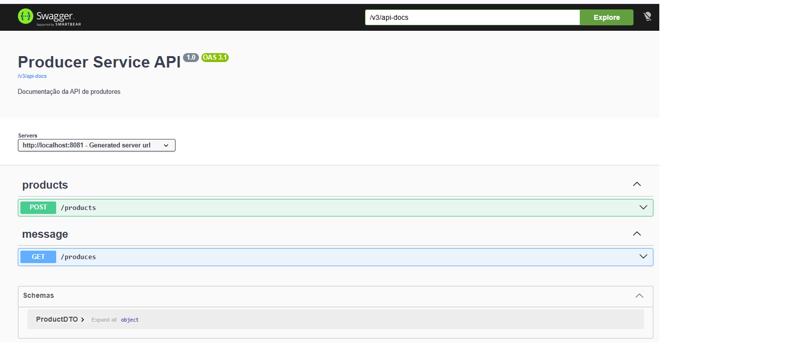

# RabbitMQ na Prática | Spring Boot

Repositório desenvolvido durante o curso **RabbitMQ na Prática**, com o objetivo de compreender e implementar comunicação assíncrona entre microsserviços utilizando RabbitMQ e Spring Boot.

O projeto apresenta a implementação de uma arquitetura baseada em Producer e Consumer, explorando exchanges, queues, routing keys, conversão de mensagens e documentação de APIs REST.

## 🎯 Objetivo do Projeto

Consolidar os conhecimentos sobre mensageria e comunicação assíncrona, implementando serviços independentes que se comunicam através do RabbitMQ.

O desenvolvimento foi organizado em módulos, permitindo compartilhar estruturas comuns e separar as responsabilidades de publicação e consumo de mensagens.

## 🏗️ Arquitetura do Projeto

O projeto está organizado em três módulos:

- **commons:** biblioteca compartilhada entre os microsserviços, contendo DTOs e estruturas comuns.
- **producer-service:** responsável por receber requisições e publicar mensagens no RabbitMQ.
- **consumer-service:** responsável por consumir e processar as mensagens recebidas.

### Fluxo de comunicação

```text
                  ┌──────────────────┐
                  │  Producer Service│
                  │                  │
                  │   RabbitTemplate │
                  └────────┬─────────┘
                           │
                           ▼
                  ┌──────────────────┐
                  │     RabbitMQ     │
                  │                  │
                  │ Direct Exchange  │
                  │ marketplace.direct
                  └────────┬─────────┘
                           │
                      Routing Key
                       product.log
                           │
                           ▼
                  ┌──────────────────┐
                  │      Queue       │
                  │   product.log    │
                  └────────┬─────────┘
                           │
                           ▼
                  ┌──────────────────┐
                  │  Consumer Service│
                  │                  │
                  │  @RabbitListener│
                  └──────────────────┘
```

## 🛠️ Tecnologias


## 📚 Conceitos e Implementações

### RabbitMQ e Mensageria

- Conceitos de mensageria e comunicação assíncrona.
- Implementação de Producer e Consumer.
- Configuração de Exchanges e Queues.
- Utilização de Direct Exchange.
- Configuração de Routing Keys.
- Associação entre Exchange e Queue através de Bindings.

### Producer Service

- Implementação de publicação de mensagens utilizando `RabbitTemplate`.
- Utilização do método `convertAndSend()`.
- Envio de objetos DTO para o RabbitMQ.
- Configuração do conversor de mensagens JSON.

### Consumer Service

- Implementação de consumidores utilizando `@RabbitListener`.
- Recebimento e conversão de mensagens.
- Desserialização de mensagens JSON para objetos Java.
- Integração com a biblioteca compartilhada.

### Biblioteca Commons

- Criação de módulo Maven compartilhado.
- Geração e instalação de JAR no repositório local Maven.
- Reutilização de DTOs entre microsserviços.
- Utilização do padrão Builder com Lombok.

### Conversão de Mensagens

- Serialização e desserialização de objetos.
- Utilização do `JacksonJsonMessageConverter`.
- Configuração do `MessageConverter` no Producer e Consumer.
- Diferenças entre serialização nativa Java e conversão JSON.
- Tratamento de restrições de segurança na desserialização.

### Documentação da API – Swagger / OpenAPI

Implementação da documentação dos endpoints REST utilizando **Springdoc OpenAPI**, disponibilizando uma interface interativa para visualizar e testar as operações da API.

**Dependência Maven:**

```xml
<dependency>
    <groupId>org.springdoc</groupId>
    <artifactId>springdoc-openapi-starter-webmvc-ui</artifactId>
    <version>3.2.0</version>
</dependency>
```

**Configuração do Swagger:**

```java
@Configuration
@OpenAPIDefinition(
    info = @Info(
        title = "Producer Service API",
        version = "1.0",
        description = "Documentação da API de produtores"
    )
)
public class SwaggerConfig {

}
```

**Funcionalidades exploradas:**

- Geração automática da documentação OpenAPI.
- Configuração das informações da API utilizando anotações.
- Visualização dos endpoints REST.
- Identificação dos métodos HTTP e parâmetros.
- Visualização dos schemas dos DTOs.
- Testes das requisições diretamente pela interface Swagger UI.

**Documentação gerada pelo Swagger UI:**



Acesso local:

```text
http://localhost:8081/swagger-ui/index.html
```

Documentação OpenAPI:

```text
http://localhost:8081/v3/api-docs
```

## 💡 Aprendizados

Durante o desenvolvimento, foi possível compreender na prática como o RabbitMQ permite desacoplar serviços e estabelecer comunicação assíncrona.

Um dos principais aprendizados foi entender que o RabbitMQ transporta mensagens em bytes, enquanto os conversores são responsáveis por transformar esses dados em objetos utilizados pelas aplicações.

Também foi explorada a importância de manter um formato de mensagem compatível entre Producer e Consumer, utilizando JSON como padrão de comunicação.

Além disso, foi implementada a documentação dos serviços REST com Swagger/OpenAPI, facilitando a visualização, compreensão e validação dos endpoints disponibilizados.

## 📖 Curso

**RabbitMQ na Prática – Udemy**

[ Acessar o curso](https://www.udemy.com/course/rabbitmq-na-pratica/learn/lecture/34452134#overview)

---

Desenvolvimento realizado com foco em aprendizado prático, arquitetura de microsserviços, integração entre aplicações e mensageria.
